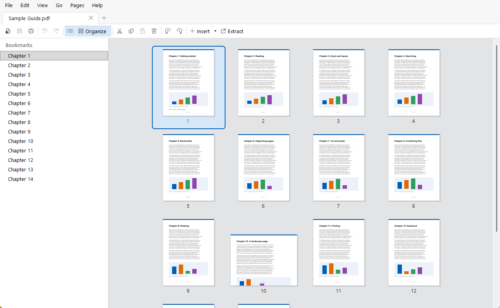

# Gravity

A fast, lightweight PDF viewer and page organizer for Windows, modeled on SumatraPDF's minimal reading experience, with the page editing Sumatra leaves out: rearrange, combine, cut, copy and paste pages between PDFs.

- One ~185 KB executable plus `pdfium.dll` (Chrome's PDF engine). Nothing to install. It runs on the .NET Framework 4.8 that ships with Windows 10 and 11.
- About 65 MB of memory with a couple of documents open.
- Rendering happens in tiles on a background thread, so scrolling and zooming never wait on the page.

| Reading | Organizing pages |
|---|---|
|  |  |

## Features

**Reading**
- Continuous scrolling, or one page (or spread) at a time. Single, facing, and book (cover alone) layouts.
- Fit page, fit width, actual size, and free zoom (Ctrl+wheel zooms around the mouse pointer).
- View rotation that never changes the file.
- Bookmarks sidebar, clickable internal links, and web/e-mail links (other link types are blocked).
- Find text, forward and backward, with optional match case.
- Select text by dragging across it, then copy it.
- Back/forward history for jumps from links, bookmarks and Go to page.
- Tabs for multiple documents. Opening a PDF from Explorer while Gravity is running adds a tab to the existing window.
- Full screen (F11) and presentation mode (F5).
- Remembers each file's page, zoom and layout. Recent files appear on the start page.
- Reloads automatically when the file changes on disk (unless it has unsaved edits).
- Printing.

**Editing pages** (press Ctrl+E or click **Organize**)
- Thumbnail grid. Click, Ctrl+click, Shift+click, or drag a box to select pages.
- Drag pages to reorder them. Dragging near the top or bottom edge scrolls.
- Cut, copy and paste pages, within one PDF or between tabs.
- Delete, duplicate, and rotate pages. Rotation is saved into the file.
- Insert a blank page, or pages from other PDFs. You can also drop PDF files onto the grid at the spot you want.
- **Combine PDFs** (File menu or start page): pick and order files, then get one new document.
- **Extract** pages to a new tab, or **Save Selected Pages As** a new PDF.
- Undo/redo (up to 300 steps), even after saving.
- Page commands also work in the reading view on the current page (Pages menu or right-click).

Nothing is written until you save. Saving goes to a temporary file first and then replaces the original, so an interrupted save never leaves a damaged PDF. When the pages still come from the original file, Gravity edits that file's own page tree. This keeps its bookmarks, metadata and form fields. An unchanged document is saved byte-for-byte.

## Keyboard shortcuts

| | |
|---|---|
| Next / previous page | N, P, Page Down, Page Up |
| Scroll | arrows, J K H L, Space / Shift+Space |
| First / last page | Home, End |
| Go to page | Ctrl+G or G |
| Back / forward | Alt+Left, Alt+Right |
| Find | Ctrl+F or /, then F3 / Shift+F3 |
| Zoom | + and -, Ctrl+wheel |
| Fit page / actual size / fit width | Ctrl+0, Ctrl+1, Ctrl+2 |
| Toggle fit page and fit width | Z |
| Single / facing / book | Ctrl+6, Ctrl+7, Ctrl+8 |
| Continuous on/off | C |
| Rotate view | [ and ] |
| Bookmarks | F12 |
| Full screen / presentation | F11 / F5 or Ctrl+L |
| Organize pages | Ctrl+E |
| Cut / copy / paste pages | Ctrl+X, Ctrl+C, Ctrl+V (Ctrl+Shift+V pastes before) |
| Delete / duplicate pages | Delete, Ctrl+D |
| Rotate pages | Ctrl+[ and Ctrl+] (also [ and ] in Organize) |
| Move pages earlier / later | Alt+Left, Alt+Right (Organize) |
| Undo / redo | Ctrl+Z, Ctrl+Y |
| Open / save / save as / print | Ctrl+O, Ctrl+S, Ctrl+Shift+S, Ctrl+P |
| Next / previous tab, tab 1-9, close tab | Ctrl+Tab, Ctrl+Shift+Tab, Alt+1...9, Ctrl+W |
| Reload from disk | R |

Press F1 in the app for the complete list.

## Using it

The `bin` folder is the whole app. Copy `Gravity.exe`, `pdfium.dll` and the `licenses` folder anywhere and run it.

### Install and make it the default PDF viewer

```powershell
.\tools\install.ps1
```

This installs Gravity for the current user. It needs no admin rights and does four things:
- copies the app to `%LOCALAPPDATA%\Programs\Gravity`
- registers it as a PDF handler
- adds a Start menu shortcut
- opens **Settings › Default apps › Gravity**

Windows only lets *you* change a default app, so finish there: click **Set default**, or choose Gravity for `.pdf`.

After rebuilding, run the script again to update the installed copy. To remove everything, run `.\tools\install.ps1 -Uninstall`.

Settings and the recent-files list are stored in `%APPDATA%\Gravity\settings.txt`.

Command line: `Gravity.exe [file.pdf ...] [-page N] [--new-window]`

## Building

```powershell
.\build.ps1
```

This uses the C# compiler included with Windows (`%WINDIR%\Microsoft.NET\Framework64\v4.0.30319\csc.exe`). No SDK or Visual Studio is needed. Output goes to `bin\`.

```powershell
.\build.ps1 -Test
```

This builds and runs the offline test suite (124 checks).

The engine tests generate their own PDFs, then check:
- reordering, cutting and pasting across documents, and rotation
- combining, duplicates and blank pages
- undo/redo and saving over the open file
- byte-identical unchanged saves
- search, bookmarks and links
- tiled rendering
- rejection of broken files

The UI tests open the real window off-screen and drive it with Windows mouse and keyboard messages:
- link clicks and history
- text selection
- zoom and layout keys
- drag-reordering in the organizer
- cut in one tab and paste into another
- save, and reload when the file changes on disk
- presentation and full-screen modes

```powershell
.\build.ps1 -Package
```

This also writes a portable zip to `dist\`.

## How it's built

| File | Role |
|---|---|
| `src/Pdfium.cs` | P/Invoke bindings for PDFium (render, text, search, bookmarks, links, page import/move/delete, save) |
| `src/Model.cs` | `PdfSource` (a PDF loaded into memory, never modified), `PageRef` (one page plus rotation), and `EditDoc` (a tab's page list, undo, save) |
| `src/Renderer.cs` | Background tile renderer with a memory-bounded LRU bitmap cache |
| `src/DocView.cs` | Reading view: layout, zoom anchoring, tiles, selection, links, search |
| `src/OrganizerView.cs` | Thumbnail grid: selection, drag reordering, file drops |
| `src/MainForm.cs` | Window, menus, toolbar, tabs, page commands, save and print, file watching |
| `src/TabStrip.cs`, `src/HomeView.cs`, `src/Dialogs.cs`, `src/Settings.cs`, `src/Canvas.cs` | Supporting UI |
| `src/Program.cs` | Startup, single-instance handoff over a per-user named pipe |
| `tests/` | Engine and UI self-tests |

Edits never touch the loaded PDFs. A tab is a list of page references, possibly from several files, so cut, paste, reorder and undo are instant list operations.

Saving builds the real PDF with PDFium in four steps:
1. Load a fresh copy of the original file.
2. Delete the pages that are no longer used.
3. Import pages from other files with `FPDF_ImportPagesByIndex`.
4. Put everything in order with `FPDF_MovePages` and apply rotations.

## Limitations

- Opens PDF only. SumatraPDF's other formats (ePub, CBZ, DjVu and so on) aren't supported.
- No annotation editing, form filling, or OCR.
- Pages pasted in from *other* files don't bring those files' bookmarks along. The original document's bookmarks are kept.
- Printing sends each page as an image at up to 300 DPI, scaled to fit the paper.
- Startup time depends on how many fonts are installed. GDI+ (used by all WinForms apps) scans the installed fonts once per process. With about 2,800 font families, that scan alone takes about 0.65 s and the window appears in about 0.8 s. Gravity overlaps the scan with loading the document. Machines with a typical font set start noticeably faster.

## Third-party software

PDFium (BSD-3-Clause / Apache-2.0), prebuilt by [bblanchon/pdfium-binaries](https://github.com/bblanchon/pdfium-binaries) (MIT), build chromium/8179. License texts are in `third_party/pdfium/` and are copied to `bin/licenses/` on build.
