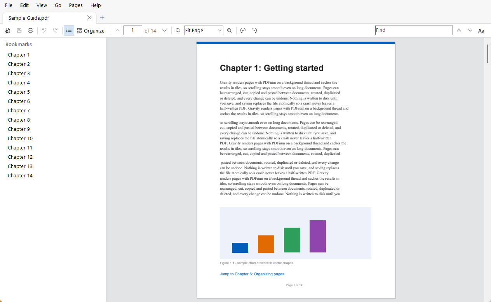
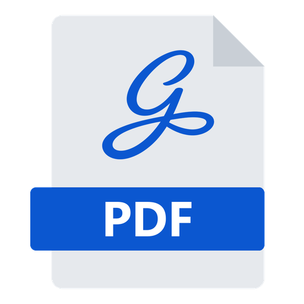

<p align="center">
  <picture>
    <source media="(prefers-color-scheme: dark)" srcset="docs/logo-dark.png">
    
  </picture>
</p>

<p align="center">A lightweight PDF viewer, form filler, and page organizer for Windows and macOS.</p>

<p align="center">
  
  <a href="LICENSE"></a>
  <a href="#windows"></a>
  <a href="#macos"></a>
  <br>
  
  
  
  
  <br>
  
  
  <a href="#form-filling"></a>
  <a href="#building"></a>
</p>

Read PDFs, fill existing form fields, and rearrange, combine, cut, copy and paste pages between documents. On Windows, search a document with a results list, export pages to images or text, and assemble images into a PDF. The Windows app uses the bundled PDF engine; the native macOS app uses Apple's PDFKit.

- Windows: a small executable plus `pdfium.dll`, running on .NET Framework 4.8. No installer required.
- Windows rendering happens in tiles on a background thread, so scrolling and zooming never wait on the page.
- macOS: a native app for Apple Silicon and Intel, built with Xcode Command Line Tools. See [macOS](#macos) for coverage and build instructions.

| Reading | Organizing pages |
|---|---|
|  |  |

## Features

The following reading and page-organizing controls describe the Windows app. macOS coverage is listed below.

The Windows interface uses bundled Lucide icons, a **Read / Organize** switch, and a shared **Outline / Pages** sidebar. The top-right **…** button reveals the application menus; the command palette and keyboard shortcuts remain available. Primary controls use rounded targets, with page-specific commands above the document and save state below it.

**Reading**
- Continuous scrolling, or one page (or spread) at a time. Single, facing, and book (cover alone) layouts.
- Fit page, fit width, actual size, and free zoom (Ctrl+wheel zooms around the mouse pointer).
- View rotation that never changes the file.
- Bookmarks sidebar, clickable internal links, and web/e-mail links (other link types are blocked).
- Find text with match counts, page numbers, snippets, optional match case, and next/previous navigation. Search runs in the background and can be cancelled. The results panel stays usable at the minimum window size.
- **Command Palette** (`Ctrl+Shift+P`): search the menu commands, see their current shortcuts, and run an available action.
- Select text by dragging across it, then copy it.
- Back/forward history for jumps from links, bookmarks and Go to page.
- Tabs for multiple documents. Opening a PDF from Explorer while Gravity is running adds a tab to the existing window.
- Full screen (F11) and presentation mode (F5).
- Remembers each file's page, zoom and layout. Recent files appear on the start page.
- Reloads automatically when the file changes on disk (unless it has unsaved edits).
- Printing.

**Editing pages**
- The **Pages** tab keeps thumbnails and page actions in the left sidebar beside the reading view. Toggle it with Ctrl+Shift+E; the sidebar's width, visibility, and last tab are remembered.
- Click a thumbnail to navigate, or select multiple thumbnails to edit pages while keeping the document visible. Press Ctrl+E or click **Organize** for the full thumbnail grid.
- Thumbnail grid. Click, Ctrl+click, Shift+click, or drag a box to select pages.
- Drag pages to reorder them. Dragging near the top or bottom edge scrolls.
- Cut, copy and paste pages, within one PDF or between tabs.
- Delete, duplicate, and rotate pages. Rotation is saved into the file.
- Insert a blank page, pages from other PDFs, or images. Drop PDFs or images onto the grid at the spot you want; use separate drops for the two file types.
- **Combine PDFs** (File menu or start page): pick and order files, then get one new document.
- **Extract** pages to a new tab, or **Save Selected Pages As** a new PDF.
- Undo/redo (up to 300 steps), even after saving.
- Page commands also work in the reading view on the current page (Pages menu or right-click).

Nothing is written until you save. Windows writes and flushes a temporary file in the destination folder, then replaces the original. If replacement fails, Gravity reports the failure and keeps your edits open; it never falls back to copying over the original. Close applications using the destination and retry, or choose another file with **Save As**. Filesystem and hardware failures still depend on the storage device's guarantees. When the pages still come from the original file, Gravity edits that file's own page tree to retain its bookmarks, metadata and form fields. Imported documents' bookmarks are not merged. An unchanged document is saved byte-for-byte.

### Find and export on Windows

Press **Ctrl+F**, type text, then select a result or use **Enter/F3** and **Shift+Enter/Shift+F3** to move through matches. **Escape** closes the results. Editing the document or changing the query invalidates old results. Searches count all matches and display the first 10,000; refine the query when that limit is reached. Scanned images without a text layer require OCR, which is not included.

Choose **File → Export Pages** for all pages, the current page, the organizer selection, or a range such as `1, 3-5, 8`. Ranges can run backwards and repeated pages are exported once.

- **PNG/JPEG:** choose 72–600 dpi and a destination folder. The output includes current page edits, saved page rotations, visible annotations and form appearances. Temporary view rotation is excluded. Filenames include the document name and page number; a numeric suffix prevents overwriting existing images. Individual images are limited to 40 million pixels and 32,767 pixels per side. Cancellation keeps completed images and removes the incomplete temporary output.
- **Text:** saves UTF-8 with page separators in the selected order. PDF text extraction can differ from visual reading order, especially with columns. Cancelling preserves an existing destination file.

### Create a PDF from images on Windows

Choose **File → Create PDF from Images**, or **Pages → Insert Images** for the open document. Add or drop **PNG, JPEG, or BMP** files, order them with **Move up/Move down**, and choose Letter, A4, or image-size pages. Fixed paper sizes support landscape orientation; margins range from 0 to 2 inches. Image-size pages use 96 dpi for their dimensions.

Each image becomes one page, fitted without cropping. Camera orientation is respected and transparent areas appear white. Imports are limited to 40 million pixels per image. The new document opens in the organizer, where you can reorder and rotate pages before saving with **Ctrl+S**. Inserting images into an existing PDF is one undoable operation. Conversion is cancellable and does not create a partial document.

### Form filling

Click an existing field, or choose **Edit → Fill Form** (`Ctrl+Shift+F` on Windows, `Command+Shift+F` on macOS). Fill text, multiline text, checkboxes, radio buttons, and choice fields. Windows also supports lists with multiple selections.

Apply changes, then **Save** or **Save As** to write them into the PDF. Form edits support undo/redo, and read-only fields stay read-only. Filled fields remain interactive when reopened. Scanned pages without interactive fields need OCR or a separate annotation editor.

JavaScript calculations, submission buttons, XFA forms, and digital signing are not supported. Editing a signed PDF can invalidate its signature.

## Keyboard shortcuts

| | |
|---|---|
| Next / previous page | N, P, Page Down, Page Up |
| Scroll | arrows, J K H L, Space / Shift+Space |
| First / last page | Home, End |
| Go to page | Ctrl+G or G |
| Back / forward | Alt+Left, Alt+Right |
| Find | Ctrl+F or /, then F3 / Shift+F3 |
| Command palette | Ctrl+Shift+P |
| Fill form fields on this page | Ctrl+Shift+F, or click a field |
| Zoom | + and -, Ctrl+wheel |
| Fit page / actual size / fit width | Ctrl+0, Ctrl+1, Ctrl+2 |
| Toggle fit page and fit width | Z |
| Single / facing / book | Ctrl+6, Ctrl+7, Ctrl+8 |
| Continuous on/off | C |
| Rotate view | [ and ] |
| Show / hide sidebar | F12 |
| Full screen / presentation | F11 / F5 or Ctrl+L |
| Show / hide Pages panel | Ctrl+Shift+E |
| Full page organizer | Ctrl+E |
| Cut / copy / paste pages | Ctrl+X, Ctrl+C, Ctrl+V (Ctrl+Shift+V pastes before) |
| Delete / duplicate pages | Delete, Ctrl+D |
| Rotate pages | Ctrl+[ and Ctrl+] (also [ and ] with thumbnails focused) |
| Move pages earlier / later | Alt+Up, Alt+Down (thumbnails focused) |
| Undo / redo | Ctrl+Z, Ctrl+Y |
| Open / save / save as / print | Ctrl+O, Ctrl+S, Ctrl+Shift+S, Ctrl+P |
| Next / previous tab, tab 1-9, close tab | Ctrl+Tab, Ctrl+Shift+Tab, Alt+1...9, Ctrl+W |
| Reload from disk | R |

Press F1 in the app for the complete list.

## Using it

Clone the source, then follow the build instructions for your platform:

```sh
git clone https://github.com/petehottelet/gravity.git
cd gravity
```

### Windows

On Windows 10 or 11 with .NET Framework 4.8, build and run from PowerShell:

```powershell
.\build.ps1
.\bin\Gravity.exe
```

The `bin` folder is the whole app. Copy `Gravity.exe`, `pdfium.dll`, `GravityPdf.ico` and the `licenses` folder anywhere and run it.

### Install and make it the default PDF viewer

```powershell
.\tools\install.ps1
```

This installs Gravity for the current user. It needs no admin rights and does four things:
- copies the app to `%LOCALAPPDATA%\Programs\Gravity`
- registers it as a PDF handler
- adds a Start menu shortcut
- opens **Settings › Default apps › Gravity**

Windows only lets *you* change a default app, so finish there: click **Set default**, or choose Gravity for `.pdf`.

PDF files then show Gravity's document icon in Explorer:



After rebuilding, run the script again to update the installed copy. To remove everything, run `.\tools\install.ps1 -Uninstall`.

Settings and the recent-files list are stored in `%APPDATA%\Gravity\settings.txt`.

Command line: `Gravity.exe [file.pdf ...] [-page N] [--new-window]`

### macOS

Build on a Mac running macOS 12 or newer with Xcode Command Line Tools installed:

```sh
bash build-macos.sh --test
open bin/Gravity.app
```

This compiles `arm64` and `x86_64` into a universal app using system PDFKit. No PDF engine download, .NET, or third-party package is required. Copy `bin/Gravity.app` to Applications if desired. In Finder, use **Get Info → Open with → Gravity → Change All** to choose it as your PDF viewer.

The native app includes document windows and macOS tabs, scrolling and zooming, text selection and search, a thumbnail sidebar with multiple selection, printing, and form filling. The **Pages** menu provides cut/copy/paste across documents, deletion, duplication, rotation, moving pages earlier/later, blank-page insertion, inserting PDFs, and extraction. Changes support undo/redo and standard save/close prompts.

Use `Command+O/S/P` for open/save/print, `Command+Shift+S` for Save As, `Command+F` to find, and `Command+Shift+F` to fill forms. Page cut/copy/paste uses `Command+Shift+X/C/V`; ordinary `Command+C` copies selected text. Select pages with Command-click or Shift-click.

Undoing all changes returns the document to its clean state and preserves the restored PDF bytes. Redo and undo across saved checkpoints update the modified indicator through AppKit's undo manager.

The macOS app does not yet include Windows' command palette, search results panel, image/text export, images-to-PDF import, bookmark sidebar, presentation mode, file watching, remembered reading positions, drag reordering, or form lists with multiple selections.

```sh
bash build-macos.sh --test --package
```

This writes `dist/Gravity-1.0.0-mac-universal.zip`. Local builds use an ad-hoc signature; they are not Developer ID signed or notarized for distribution.

## Building

```powershell
.\build.ps1
```

This uses the C# compiler included with Windows (`%WINDIR%\Microsoft.NET\Framework64\v4.0.30319\csc.exe`). No SDK or Visual Studio is needed. Output goes to `bin\`.

```powershell
.\build.ps1 -Test
```

This builds and runs the offline engine and UI test suite.

The engine tests generate their own PDFs, then check:
- reordering, cutting and pasting across documents, and rotation
- combining, duplicates and blank pages
- undo/redo and saving over the open file
- byte-identical unchanged saves
- failed replacement and serialization preserving existing files, edits and undo
- search, bookmarks and links
- search counts, page ranges, PNG/JPEG export, UTF-8 text export and cancellation
- image-to-PDF conversion, paper sizes, margins, rotation and reopening
- tiled rendering
- form values, widget appearances, read-only fields, saving, and undo after saving
- rejection of broken files

The UI tests open the real window off-screen and drive it with Windows mouse and keyboard messages:
- link clicks and history
- text selection
- zoom and layout keys
- drag-reordering in the organizer
- collapsing and expanding the Pages panel, navigation, multi-page actions, and keyboard focus
- cut in one tab and paste into another
- save, and reload when the file changes on disk
- presentation and full-screen modes
- opening form fields from the keyboard and by clicking, applying values, and canceling
- Find results, cancellation, stale query rejection and small-window controls
- command palette filtering, execution and disabled actions
- image insertion with undo and export range validation

The optional icon generator has a separate offline regression check, requiring Python and Pillow:

```powershell
python -m unittest discover -s tests -p "test_*.py"
```

```powershell
.\build.ps1 -Package
```

This also writes a portable zip to `dist\`.

`.github/workflows/checks.yml` builds and tests Windows and macOS. It has no release or upload step. The macOS build treats compiler warnings as errors and runs its PDFKit model and window-construction tests; Windows also runs `ruff check .` and the Python icon tests.

## How it's built

| File | Role |
|---|---|
| `src/Pdfium.cs` | P/Invoke bindings for the PDF engine (render, text, search, bookmarks, links, page import/move/delete, save) |
| `src/Model.cs` | `PdfSource` (a PDF loaded into memory, never modified), `PageRef` (one page plus rotation), and `EditDoc` (a tab's page list, undo, save) |
| `src/AtomicFile.cs` | Flushed temporary writes and safe replacement for saving and export |
| `src/DocumentSearch.cs`, `src/SearchPanel.cs` | Cancellable search and navigable match results |
| `src/DocumentExport.cs`, `src/ImageImport.cs` | Text/image export, page ranges, and image-to-PDF conversion |
| `src/FeatureDialogs.cs` | Command palette, export/import options, and cancellable job progress |
| `src/Renderer.cs` | Background tile renderer with a memory-bounded LRU bitmap cache |
| `src/DocView.cs` | Reading view: layout, zoom anchoring, tiles, selection, links, search |
| `src/OrganizerView.cs` | Thumbnail grid: selection, drag reordering, file drops |
| `src/MainForm.cs` | Window, menus, toolbar, tabs, page commands, save and print, file watching |
| `src/TabStrip.cs`, `src/HomeView.cs`, `src/Dialogs.cs`, `src/Settings.cs`, `src/Canvas.cs` | Supporting UI |
| `src/Program.cs` | Startup, single-instance handoff over a per-user named pipe |
| `src/PdfForms.cs`, `src/FormEditor.cs` | AcroForm field access, editing controls, and widget rendering |
| `macos/`, `build-macos.sh` | Native AppKit/PDFKit app, offline tests, and universal packaging |
| `tests/` | Engine and UI self-tests |
| `tools/make_brand.py`, `assets/` | Generates the app and PDF document icons from the G mark (`assets/g-mark.png`). Needs Python, Pillow and the Windows Segoe UI Bold font for the PDF label: `python tools/make_brand.py` |
| `src/Lockup.png`, `docs/logo-light.png`, `docs/logo-dark.png` | Finished logo artwork used by the app and README; no logo generation or wordmark font is needed |
| `tools/install.ps1` | Per-user install, PDF file association, Start menu shortcut |

Edits never touch the loaded PDFs. A tab is a list of page references, possibly from several files, so cut, paste, reorder and undo are instant list operations.

On Windows, applying form values creates an immutable document snapshot. The same history stores page edits and form edits, while the renderer draws widgets over page content. On macOS, PDFKit handles rendering and serialization, and AppKit handles document windows and safe saving.

Saving builds the real PDF with the bundled engine in four steps:
1. Load a fresh copy of the original file.
2. Delete the pages that are no longer used.
3. Import pages from other files with `FPDF_ImportPagesByIndex`.
4. Put everything in order with `FPDF_MovePages` and apply rotations.

## Limitations

- Reads PDF documents. Windows can convert PNG, JPEG and BMP images into PDF pages; other document formats are not supported.
- No annotation editing or OCR. Form filling is limited to existing AcroForm fields.
- Pages pasted in from *other* files don't bring those files' bookmarks along. The original document's bookmarks are kept.
- Printing sends each page as an image at up to 300 DPI, scaled to fit the paper.
- Startup time depends on how many fonts are installed. GDI+ (used by all WinForms apps) scans the installed fonts once per process. With about 2,800 font families, that scan alone takes about 0.65 s and the window appears in about 0.8 s. Gravity overlaps the scan with loading the document. Machines with a typical font set start noticeably faster.

## Feature reference and UI concept

- [Gravity roadmap](docs/GRAVITY_ROADMAP.md): current increment, remaining priorities and acceptance criteria.
- [SumatraPDF feature dossier](docs/SUMATRAPDF_DOSSIER.md): detailed comparison across reading, editing, formats and automation.
- [Reference index](docs/SUMATRAPDF_REFERENCE_INDEX.md): linked command, setting and scripting inventories, with a [JSON catalog](docs/sumatrapdf-reference-catalog.json).
- [Lucide UI concept](docs/ui-draft/README.md): an offline browser prototype of the selected reading/organizing design. Open `docs/ui-draft/index.html` locally to compare it with the saved reference screenshots. This concept has not replaced the native interface.

## License

Gravity's original source code is available under the [MIT License](LICENSE), including commercial use, modification, redistribution, and sale, provided the copyright and permission notice is retained.

The bundled Windows PDF engine and its components retain their own licenses. These permit commercial use subject to their notice and other license conditions; they are not relicensed under Gravity's MIT license. See [Third-party notices](THIRD_PARTY_NOTICES.md) for the component inventory and required acknowledgments. The build includes these notices and the full license texts in `bin/licenses/`.
