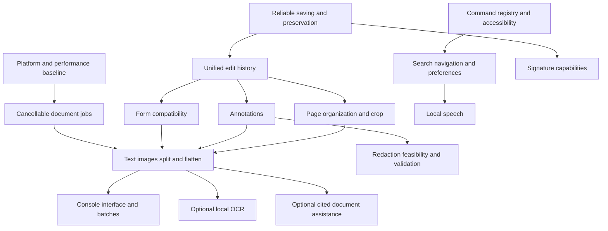

# Gravity product and engineering roadmap

Planning reference: November 24, 2026.

## Implemented Windows increment

The initial five-feature increment is now implemented in source. The broader acceptance criteria below remain the long-term plan; this table records the narrower completed scope.

| Roadmap area | Implemented scope | Remaining scope |
| --- | --- | --- |
| G01 saves | Flush a same-folder temporary file; replace atomically or report failure; no destructive copy fallback; failure regression tests | Recovery snapshots and broader filesystem/platform testing |
| G06 commands | Searchable Windows menu command palette with shortcuts and current availability | Shared cross-platform command specification and configurable shortcuts |
| G08 search | Cancellable document search, total count, up to 10,000 result snippets, page navigation and stale-result rejection | Broader multilingual corpus, advanced matching and Mac parity |
| G19 export | PNG/JPEG page ranges at 72–600 dpi; unique image names; UTF-8 text export; cancellation | Region export, output templates and Mac parity |
| G20 images | PNG/JPEG/BMP to new PDF or inserted pages; ordering, paper size, margins and orientation; organizer preview and undo | Additional formats, richer preview controls and Mac parity |

The native Mac undo change removes duplicate modified-state counting and preserves restored PDF bytes, with regression tests for grouped edits and saved checkpoints. The [README](../README.md) describes the current user-facing controls and platform differences. The [UI prototype](ui-draft/README.md) remains a separate design concept.

Gravity should become a dependable PDF reader, form filler and page editor on Windows and macOS. The next investment should protect documents and finish common workflows: find and navigate, mark up, fill forms, assemble pages, export and print. The wider SumatraPDF feature set provides a useful catalog of possibilities, but format breadth, scripting and AI should follow demonstrated demand.

This roadmap uses the current source, including the forms and native macOS implementation, as its starting point. It is a proposal with completion gates, not a release announcement or a claim that the work is already implemented. The [feature dossier](SUMATRAPDF_DOSSIER.md) explains each comparison; the [reference index](SUMATRAPDF_REFERENCE_INDEX.md) preserves the complete documentation and identifier inventories.

## Contents

- [Product direction](#product-direction)
- [Starting point and immediate decisions](#starting-point-and-immediate-decisions)
- [Phases and planning assumptions](#phases-and-planning-assumptions)
- [P0 Establish a trustworthy baseline](#p0-establish-a-trustworthy-baseline)
- [P1 Improve everyday reading](#p1-improve-everyday-reading)
- [P2 Complete the editing foundation](#p2-complete-the-editing-foundation)
- [P3 Add practical document tools](#p3-add-practical-document-tools)
- [P4 Support repeatable workflows](#p4-support-repeatable-workflows)
- [P5 Choose advanced capabilities deliberately](#p5-choose-advanced-capabilities-deliberately)
- [Architecture decisions and dependencies](#architecture-decisions-and-dependencies)
- [Validation and quality gates](#validation-and-quality-gates)
- [Prioritization and decision gates](#prioritization-and-decision-gates)
- [First implementation sequence](#first-implementation-sequence)
- [Traceability](#traceability)

## Product direction

### Primary users and jobs

| User | Important job | Product outcome |
| --- | --- | --- |
| Everyday reader | Open, find, follow references, remember a place and print | A responsive reader with predictable navigation |
| Person completing documents | Fill a form, add a note or signature image, save and reopen | Values and markup appear correctly in other viewers |
| Person assembling documents | Combine, reorder, remove, rotate, crop and split pages | A visible, reversible workflow that preserves document structure |
| Researcher or technical reader | Navigate long documents, inspect figures and export text | Searchable results, outlines, citations and precise region export |
| PDF author | Rebuild a PDF repeatedly and jump between source and output | Reliable reload and optional source synchronization |
| Power user | Repeat a known transformation across files | A documented console interface with safe outputs and machine-readable results |

Accessibility, local document handling and preservation apply to every job. They should not become separate optional editions of the application.

### Product principles

1. **Keep the original safe.** Save and export behavior must have explicit failure semantics. A cancelled operation must not leave a damaged file presented as complete.
2. **Make edits reversible.** Page edits, forms and annotations belong to a coherent document history. View changes should not create misleading document changes.
3. **Respect native conventions.** Use familiar Windows and Mac commands while maintaining the same document-operation contract.
4. **Keep reading responsive.** Search, export, optimization and large-file operations need cancellation and bounded resource use.
5. **Preserve what Gravity does not understand.** Unsupported annotation types, attachments and metadata should survive unrelated edits where the engine permits; limitations must be explicit.
6. **Make network use intentional.** Core reading and editing should work offline. Optional external services need visible data boundaries.
7. **Earn advanced claims.** Secure redaction, signature verification, exact-size printing and accessibility need specific evidence, not just a button or a successful save.

### Scope boundaries

The core plan does not include general word-processor-style PDF text reflow, a cloud document library, real-time collaboration, an ebook store, DRM removal, browser embedding or a universal scripting environment. Those are different products or substantial expansions. They can be reconsidered when a concrete user job justifies the ongoing complexity.

Image-to-PDF belongs in the core because it supports document assembly. EPUB/CHM/DjVu/OFD support belongs in a later format decision. A handwritten signature image belongs with annotations; certificate signing belongs in a separate trust and serialization project.

## Starting point and immediate decisions

At the planning baseline, Gravity already had Windows reading layouts, zoom, search, bookmarks, links, tabs, recent positions, auto-reload, printing, a page panel and a full organizer. Its page operations and forms should be treated as existing capabilities to improve, not new features to rebuild. Mac has native PDFKit reading and many editing operations, with differences identified in the README. The increment above extends that baseline. [Baseline capability matrix](SUMATRAPDF_DOSSIER.md#current-capability-matrix).

Three decisions should govern the first implementation work:

- Retain PDFium on Windows and PDFKit on Mac initially. Define common semantics and tests before considering a shared-engine migration.
- Fix save integrity and clarify preservation before adding operations that rewrite more of a PDF.
- Introduce a shared command specification and capability model, while keeping the actual native UIs and native engine adapters separate.

The first concrete issue was the Windows save fallback from `File.Replace` to overwriting with `File.Copy`. The implemented increment removes that fallback and narrows the README's safety statement to the behavior actually provided. Recovery and broader storage testing remain in G01. [AtomicFile.cs](../src/AtomicFile.cs).

## Phases and planning assumptions

Effort ranges below are preliminary engineering estimates for one experienced maintainer, with access to Windows and Mac hardware and occasional design/testing support. They include implementation and focused validation. They exclude waiting for certificates, distribution accounts, external approvals or unknown engine limitations. These are capacity assumptions, not measured delivery velocity.

| Phase | Intended outcome | Included work | Initial range | Exit gate |
| --- | --- | --- | --- | --- |
| P0 | Trustworthy baseline | G01–G05 | 3–5 engineering weeks | Save failures, preservation scope and platform status are explicit and tested |
| P1 | Better everyday reading | G06–G12 | 4–6 engineering weeks | Core workflows discoverable and usable with keyboard and assistive technology |
| P2 | Complete editing foundation | G13–G17 | 6–10 engineering weeks | Forms and common annotations survive edits, undo and independent reopening |
| P3 | Practical document tools | G18–G24 | 5–8 engineering weeks | Export, crop, split, flatten and print produce predictable outputs |
| P4 | Repeatable workflows and distribution | G25–G28 | 4–7 engineering weeks | Stable console contract, batch behavior and validated platform packages |
| P5 | Selective advanced capabilities | G29–G36 | Separately estimated after feasibility | Each capability meets its own engine, privacy and correctness gate |

P0–P4 sum to roughly **22–36 engineering weeks**. A 30% contingency gives approximately **29–47 weeks**, before any major architecture change. This is a planning envelope for the full proposed scope, not a reason to wait that long for useful releases. Ship coherent increments after their gates pass. Re-estimate after P0 and after the first annotation prototype.

Accessibility begins in P0/P1 and continues through every later phase. Mac parity work continues alongside each feature. Distribution validation starts early even though the consolidated packaging milestone is in P4. Security-sensitive advanced features must not be rushed into the core schedule merely to achieve a comparison-table checkmark.

### Effort labels for individual items

**S** is approximately 2–5 engineering days, **M** is 1–2 weeks, **L** is 3–5 weeks, and **XL** requires a time-boxed investigation before a credible estimate. Item sizes overlap because several features share command, history and export infrastructure; do not mechanically add them to derive a second schedule.

## P0 Establish a trustworthy baseline

### G01 Reliable saves and recovery

**Priority:** critical. **Size:** M. **Dependencies:** none. **Dossier:** D29–D36 and saving analysis.

Replace the overwrite-copy fallback with a documented strategy that preserves the existing destination if safe replacement fails. Validate the fully written temporary result before the final swap where practical. Define when disk flushing is required and what guarantees the supported filesystem operations actually provide. Keep the UI dirty until both serialization and final replacement have succeeded.

Acceptance criteria:

- Injected write, flush, replace, access-denied and out-of-space failures leave the original bytes intact.
- A failed Save does not clear dirty state, discard undo or silently change the active file identity.
- Save As refuses accidental replacement without the normal overwrite choice and leaves unrelated files untouched.
- Temporary-file cleanup and recovery behavior are documented and tested without deleting unrelated files.
- The README's guarantee matches tested behavior, including unsupported filesystems and network destinations.

Primary work: [Model.cs](../src/Model.cs), [MainForm.cs](../src/MainForm.cs), [SelfTest.cs](../tests/SelfTest.cs). Mac's NSDocument path needs equivalent failure checks, not a literal port of Windows file operations.

### G02 Document preservation contract

**Priority:** critical. **Size:** L. **Dependencies:** G01. **Dossier:** D25, D27–D36, D40.

Define a matrix of what each operation preserves: pages, metadata, outlines, links, named destinations, labels, form values/appearances, attachments, optional content, accessibility tags, encryption and signatures. Distinguish unchanged-byte copying from serialization of an edited file. Identify operations that cannot preserve a category and choose a clear restriction or warning.

Acceptance criteria:

- Fixtures cover page movement, deletion and duplication with internal destinations and outlines.
- Cross-document import includes colliding field names, shared fields and repeated resources.
- Unsupported annotation subtypes and attachments survive unrelated page edits where promised.
- Encrypted and signed inputs have explicit edit/save behavior; unchanged copies remain byte-identical.
- Every fixed defect receives a regression fixture that fails under the old behavior.

The outcome is a tested contract, not a claim of universal PDF preservation. Primary work: [Model.cs](../src/Model.cs), [PdfForms.cs](../src/PdfForms.cs), [PDFModel.swift](../macos/PDFModel.swift), [tests](../tests/), [Mac tests](../macos/Tests.swift).

### G03 Validate and label the Mac baseline

**Priority:** high. **Size:** M. **Dependencies:** none; preservation work informs results. **Dossier:** baseline and D03.

Build the universal application on supported Mac hardware, run the native offline suite and exercise open, encrypted open, search, page actions, forms, undo, save, close and print preview. Record exact native capability differences rather than declaring parity from shared menu names.

Acceptance criteria:

- arm64 and x86_64 builds complete under the documented toolchain, with runtime coverage on the available architectures stated accurately.
- Mac fixtures exercise save/reopen and undo around forms and page changes.
- Keyboard-only use follows Mac conventions and does not intercept typing in fields.
- Missing features have explicit statuses in documentation; source-build status is distinct from distribution readiness.
- A Windows-only run never claims the Mac checks passed.

Primary work: [build-macos.sh](../build-macos.sh), [macOS sources](../macos/), [checks.yml](../.github/workflows/checks.yml).

### G04 Performance and resource budgets

**Priority:** high. **Size:** M initially, then continuous. **Dependencies:** none. **Dossier:** architecture and D10–D12.

Measure startup, first-page render, scrolling, search, thumbnail generation, save and long edit sessions. Separate bitmap cache memory from document bytes, text pages, native allocations and undo snapshots. Check worker cancellation and the consequences of the global PDFium lock. Characterize Mac snapshot-based undo separately.

Acceptance criteria:

- A reproducible benchmark corpus and hardware profile produce p50 and p95 measurements.
- Closing documents releases sources no longer retained by tabs, clipboard or undo history.
- Repeated form edits and save/undo cycles do not grow memory without a documented bound.
- Long background operations expose cancellation and do not block ordinary input indefinitely.
- Initial numerical budgets are set after baseline measurement and enforced by comparable regression runs.

Primary work: [Renderer.cs](../src/Renderer.cs), [Model.cs](../src/Model.cs), [DocView.cs](../src/DocView.cs), [GravityDocument.swift](../macos/GravityDocument.swift).

### G05 Private diagnostics and compatibility fixtures

**Priority:** high. **Size:** M. **Dependencies:** none. **Dossier:** D67–D69.

Provide a local diagnostic summary containing application/engine versions, architecture and capability information. Keep document contents, full paths, passwords and account information out by default. Expand the self-generated/publicly distributable fixture corpus and document how to reduce a failing document safely.

Acceptance criteria:

- Diagnostic export has a preview and includes only intentionally selected fields.
- Core reading and editing pass with networking unavailable.
- Test files are generated or have clear redistribution rights and contain no private materials.
- Baseline fixtures include large, scanned, rotated, mixed-size, encrypted, malformed, forms, attachments and annotated PDFs.
- Rendering failures, parsing failures, permission failures and serialization failures have distinct user-facing explanations.

Do not add automatic crash uploads as an incidental part of logging. Local diagnostics can ship independently of any report service.

## P1 Improve everyday reading

### G06 Shared commands and command palette

**Priority:** high. **Size:** M. **Dependencies:** basic capability inventory. **Dossier:** D52–D53.

Define stable command identifiers and metadata: label, aliases, category, scope, current shortcut, capability requirements, enabled state and execution. Wire existing menus and shortcuts through the registry, then add a searchable palette. Initial modes should cover commands, open documents, recent files and outlines.

Acceptance criteria:

- Every existing core action remains available and keeps its established platform shortcut.
- Disabled commands explain why when that is useful; impossible commands do not execute through alternate entry points.
- Palette filtering and keyboard selection work with localized labels and Unicode queries.
- Shortcut handling respects text fields, form editing and thumbnail focus.
- Menus, palette and toolbar display the same current binding.

Primary work: [MainForm.cs](../src/MainForm.cs), [Dialogs.cs](../src/Dialogs.cs), [App.swift](../macos/App.swift), [DocumentWindow.swift](../macos/DocumentWindow.swift). Avoid a broad UI rewrite simply to introduce the registry.

### G07 Accessibility foundation

**Priority:** high. **Size:** L, continuing through all phases. **Dependencies:** G06 helps consistent command names. **Dossier:** D22.

Audit the full open/read/find/form/page-edit/save workflow with keyboard and screen reader. Implement document text and selection exposure for Windows custom controls, accessible names/states for thumbnails and toolbar controls, predictable focus and meaningful progress/error announcements. Verify Mac accessibility rather than relying solely on PDFKit defaults.

Acceptance criteria:

- Users can open a PDF, read text, follow a link, search, fill a field and save without a mouse.
- Focus is visible and restored after dialogs, panels and full screen close.
- Screen readers can identify page context, selected items, editable fields and current values.
- High contrast, enlarged text and common display scaling do not hide essential actions.
- Narrator and at least one additional Windows screen reader are checked; VoiceOver is checked on Mac.

Automated accessibility structure checks supplement actual assistive-technology testing. No broad conformance claim should precede a defined assessment scope.

### G08 Search results and Unicode behavior

**Priority:** high. **Size:** M. **Dependencies:** G04, G06. **Dossier:** D18.

Add incremental, cancellable search with total matches, snippets, page references and a results panel. Keep per-document search state. Support match case and whole word, with normalization behavior documented. Add optional page ranges after the basic result model is reliable.

Acceptance criteria:

- Typing a new query cancels or supersedes earlier work and cannot show stale results.
- Clicking a result navigates accurately after rotation and within supported view layouts.
- Scanned pages without text produce an informative state.
- Unicode, ligatures, hyphenation, bidirectional text and repeated terms have fixture coverage.
- Reloads and edits invalidate results safely; the active query can be rerun.

Use the extraction model directly; do not maintain inconsistent search implementations for the palette, document view and later CLI.

### G09 Properties and page labels

**Priority:** high. **Size:** S–M. **Dependencies:** none. **Dossier:** D17, D46.

Add document properties for metadata, format version, size, page count/dimensions, encryption, forms, attachments and signature presence. Display physical index and authored page label distinctly. Include engine/version information for support without mixing it into routine reading controls.

Acceptance criteria:

- A document labeled `i, ii, 1, 2` is navigable without confusing printed labels with physical indices.
- Properties accurately distinguish signature presence from verified validity.
- Missing or malformed metadata is handled without failure or invented values.
- Dimensions and rotation are correct for nonzero page origins and mixed sizes.
- Copying properties omits private paths unless explicitly requested.

This is a small, useful diagnostic feature that should ship before advanced low-level PDF inspectors.

### G10 Favorites and session lifecycle

**Priority:** high. **Size:** M. **Dependencies:** settings schema and G06. **Dossier:** D10, D15, D49.

Add personal reading marks, reopen-closed, restored windows/tabs, lazy inactive-tab loading and missing-file relocation. Treat personal favorites separately from embedded PDF bookmarks. Define how a session with unsaved changes is recovered rather than confusing remembered view state with saved document content.

Acceptance criteria:

- A favorite returns to the intended page and within-page location after reopening.
- A missing/network file does not freeze startup or disappear without explanation.
- Session restore does not silently discard dirty documents or treat them as saved.
- Clear History and disable-history settings apply to sessions and recent entries according to documented rules.
- Opening the same file repeatedly has predictable reuse behavior across windows.

Recovery of unsaved documents may ship as a second increment if a safe serialized recovery format is required. Do not claim it is supplied by the existing recent-file list.

### G11 Preferences and reading colors

**Priority:** medium-high. **Size:** M. **Dependencies:** G06, G07. **Dossier:** D54–D55.

Introduce versioned preferences, shortcut customization and light/dark/system themes. Separate application colors from document recoloring. Provide reset-one-setting, reset-one-document and clear-history actions. Persist settings atomically and tolerate unknown fields during upgrades.

Acceptance criteria:

- Invalid settings fall back safely without losing unrelated valid settings.
- Shortcut collisions are visible and recoverable.
- Theme changes preserve contrast for selection, annotations, form fields and focus.
- Document reading colors do not silently change exported or printed output.
- Global defaults and per-document overrides have an understandable precedence.

Do not duplicate SumatraPDF's hundreds of settings merely for parity. Add settings that correspond to supported Gravity behavior and actual user needs.

### G12 Navigation and reading improvements

**Priority:** high for Mac outlines, medium for advanced controls. **Size:** M–L. **Dependencies:** G06, G07, geometry contract. **Dossier:** D11–D14, D19–D21.

Deliver Mac bookmarks and navigation history, fit-content, next/previous chapter, keyboard link following, and improved presentation parity. Add internal-link hover previews after the core destination model is stable. Treat right-to-left layout, reading bars, automatic scrolling and two-column reading as separate optional increments.

Acceptance criteria:

- Back/forward restores the previous viewport after outline, link and search jumps.
- Fit modes behave consistently on mixed sizes, rotation and small windows.
- Links expose a destination and obey the same policy on both platforms.
- Presentation exits to the previous layout and focus; multiple-monitor behavior is checked.
- Preview rendering is cancellable and does not stall the main document.

Keep the existing adjacent Pages panel and full organizer; these improvements should not require switching modes for every navigation action.

## P2 Complete the editing foundation

### G13 Form compatibility and interaction

**Priority:** high. **Size:** M–L. **Dependencies:** G01–G03, G07. **Dossier:** D25.

Polish the existing form editor rather than adding a second form engine. Add useful field highlighting and traversal, complete Mac multiple-selection choices where feasible, and improve descriptions of unsupported calculation/XFA workflows. Preserve shared field identities and export values.

Acceptance criteria:

- Text, multiline, checks, radios and choices retain values and appearances after independent reopening.
- Shared-name fields and radio groups behave consistently across pages.
- Read-only fields and form-entry permissions are enforced separately.
- Max length, Unicode, password-style fields, choice labels/export values and empty values have coverage.
- Cancel, apply, undo, redo and save-after-undo produce predictable dirty state.

Do not enable arbitrary document JavaScript as a shortcut to calculated forms. Any calculation support needs a separate capability and isolation decision.

### G14 Unified document edit history

**Priority:** high. **Size:** L. **Dependencies:** G02, G04. **Dossier:** D23–D36.

Extend the edit model to represent page, form, annotation and crop operations with stable identities and meaningful undo labels. Decide which changes use immutable snapshots, deltas or engine transactions. Establish a memory budget for history and an explicit policy for save/rebase.

Acceptance criteria:

- Mixed operations undo in the order the user performed them.
- Save does not unexpectedly destroy the intended undo behavior.
- A failed operation rolls back completely, including cached rendering and selection.
- Reordered/duplicated pages retain consistent associated annotations and forms.
- History retention has measured memory behavior on both platforms.

This is the dependency that prevents annotations, forms and page organization from becoming separate inconsistent editors. Prototype against realistic mixed-operation sequences before locking the internal representation.

### G15 Common annotations

**Priority:** high. **Size:** L. **Dependencies:** G07, G14, engine feasibility. **Dossier:** D23–D24.

Implement highlight, underline, strikeout and text notes with color, note text, selection, deletion and a navigable list. Store standard PDF annotation objects with correct appearance and geometry. Preserve unknown subtypes.

Acceptance criteria:

- Multi-line selections generate correct quadrilaterals at all supported rotations.
- Saved annotations display and remain editable in at least two independent readers where the subtype is supported.
- The list follows page edits and supports keyboard navigation.
- Creation/edit/delete integrates with undo and dirty state.
- Existing third-party annotations survive a save even when Gravity cannot edit them.

Investigate PDFium and PDFKit differences in a prototype first. Restrict the initial subtype set if one engine cannot reliably preserve the needed attributes.

### G16 Free text and visual markup

**Priority:** medium. **Size:** M–L. **Dependencies:** G15. **Dossier:** D23, D26.

Add free text, rectangles/lines, ink and image stamps in small increments. Support placement, movement, resizing, opacity and predictable defaults. Provide a signature-image action whose wording does not imply cryptographic signing.

Acceptance criteria:

- Placement and resizing are independent of zoom/DPI and correct on rotated/cropped pages.
- Unicode free text uses a reproducible font/appearance strategy.
- Ink strokes remain bounded in memory and undo as meaningful gestures.
- Image alpha and aspect ratio survive saving and printing.
- Cross-page copy/paste and repeated-page behavior have defined semantics.

Defer complex polygon tooling, rich free-text typography and arbitrary image replacement until the common markup tools have reliable interoperability.

### G17 Page organization and destination preservation

**Priority:** high. **Size:** M. **Dependencies:** G02, G14. **Dossier:** D29–D32.

Improve the existing organizer with range selection, visible page counts, origin information, keyboard movement and a clearer insertion preview. Add Mac drag reordering when its model and accessibility behavior are ready. Preserve/remap document destinations according to the contract established in G02.

Acceptance criteria:

- Selection survives appropriate edits and focuses a sensible page after deletion.
- Drag and keyboard operations produce identical page order.
- Empty documents are rejected, and undo restores removed pages and related state.
- Import handles password prompts and failure without partially mutating the target.
- Merge metadata, outlines and form-name conflicts have explicit policies.

Do not rewrite the Windows organizer merely to resemble SumatraPDF's separate merge window. Gravity's reading-adjacent editing is already a useful design.

## P3 Add practical document tools

### G18 Crop and page boxes

**Priority:** medium-high. **Size:** M. **Dependencies:** G14, geometry contract. **Dossier:** D33.

Add a crop preview with drag handles, numeric margins, units, selected pages and reset. Keep temporary view trimming separate from a saved CropBox edit. Account for source rotation, nonzero origins and mixed sizes.

Acceptance criteria:

- Crop preserves searchable text and vector content.
- Undo restores previous boxes exactly.
- Crop bounds remain valid and nonempty, with correct behavior for rotated pages.
- Preview and saved output agree in independent viewers.
- UI and help explicitly state that cropped content can remain in the file.

Secure content removal belongs to G30, not this feature.

### G19 Text and image export

**Priority:** high. **Size:** M. **Dependencies:** G04, G08. **Dossier:** D37–D39, D43.

Provide plain-text export, rendered-page export and rectangular region export. Use page ranges, output templates, format/DPI choices and explicit overwrite handling. Define whether the job includes current unsaved edits, visible annotations and form appearances; the default should match an understandable document-state contract.

Acceptance criteria:

- UTF-8 text has explicit page separators and stable ordering rules.
- Image size matches requested DPI or pixel dimensions independent of screen zoom.
- Export is cancellable and does not exhaust memory on large pages.
- File collisions and partial jobs are identified before/after processing.
- Selection coordinates stay correct after zoom, crop and rotation.

Add structured JSON text after the basic extraction model is tested. Markdown export is later because headings and reading structure require additional heuristics.

**Follow-on output tools:** page numbering and text/image watermarks can use this job infrastructure after P3. Provide a preview, selected ranges, cover-page skipping, a starting number, placement, opacity and over/under choices. Acceptance requires correct placement on rotated/mixed-size pages, preserved searchable text, predictable font handling and a separate output copy. These extensions are additional scope to estimate after the core exports, not implied by completing G19.

### G20 Images to PDF

**Priority:** high. **Size:** M. **Dependencies:** G01, G17. **Dossier:** D41.

Allow image insertion into the organizer and creation of a new PDF from selected images. Include ordering, paper dimensions, margins, orientation, original-resolution choices and a preview. Start with a small documented format set.

Acceptance criteria:

- EXIF orientation, alpha, very large dimensions and mixed image sizes are tested.
- JPEG recompression is avoided when the chosen output policy permits lossless embedding.
- Multipage inputs have an explicit page-selection behavior.
- The resulting PDF has predictable physical dimensions and prints at the intended scale.
- Corrupt images fail individually without corrupting a partially edited document.

Do not expand this task into archive/comic support until decompression limits and natural ordering are specified.

### G21 Split and richer assembly outputs

**Priority:** medium-high. **Size:** M. **Dependencies:** G17, G19 job infrastructure. **Dossier:** D30–D31.

Add a Split dialog for explicit ranges and fixed-size groups, plus saved assembly recipes if demand appears. Bookmark-based splitting can follow once outline preservation is dependable. Let users preview output names and page counts before writing.

Acceptance criteria:

- Page-range grammar is shared with export and the future CLI.
- Invalid, empty, duplicate and reversed ranges have documented behavior.
- No output overwrites an input accidentally.
- Cancellation produces a clear list of completed and uncompleted outputs.
- Each output reopens and contains exactly the selected pages and promised metadata.

Keep extraction into a new tab as a fast existing path; splitting into multiple files is a separate workflow.

### G22 Flattened export

**Priority:** medium. **Size:** M. **Dependencies:** G13–G16, G19. **Dossier:** D36.

Offer a separate flattened copy for forms, annotations or both, subject to engine support. Ensure current appearances exist before removing interactive objects. Keep the source editable.

Acceptance criteria:

- Values and markup remain visible after reopening and printing in independent readers.
- Flattened categories no longer remain as editable widgets/annotations.
- Text remains selectable where the chosen engine path supports it; any rasterization is explicit.
- Signed-document consequences are stated before transformation.
- The operation does not imply protection from all future editing.

If one backend only offers a raster fallback, present that as an explicit export mode rather than silently changing the quality contract.

### G23 Predictable printing

**Priority:** high. **Size:** M–L. **Dependencies:** geometry and output contract. **Dossier:** D47–D48.

Add or refine preview, actual-size, shrink, fit, page-range and selected-page behavior. Align rendering of forms and annotations with saved output. Respect platform printer capabilities while keeping the application-level choices understandable.

Acceptance criteria:

- A measured calibration page prints within an agreed tolerance on documented hardware/settings.
- Mixed dimensions/orientations, margins and current-page printing are correct.
- High-resolution drawings and barcodes remain readable under supported settings.
- Cancel stops further submission where possible and clearly distinguishes queued pages from printed pages.
- Printer errors do not mark a document saved or change its contents.

Vector printing is an investigation, not a prerequisite justified by SumatraPDF parity; its documented print path is also raster-based. Poster tiling remains a later increment after scale is trustworthy.

### G24 Attachments and temporary-file retention

**Priority:** medium. **Size:** M. **Dependencies:** G02, G10. **Dossier:** D40, D49.

Expose embedded attachments with explicit save/open actions. Detect likely temporary input locations and offer a durable copy while preserving the current state. Use safe filenames and collision handling.

Acceptance criteria:

- Embedded names cannot escape the destination directory or overwrite an unrelated file silently.
- Saving an attachment does not execute it.
- Supported PDF attachments open as documents with normal permission and link behavior.
- Keeping a temporary document preserves unsaved changes and reading location according to a documented flow.
- Unrelated page/form edits preserve attachments promised by G02.

Attachment inspection also becomes a prerequisite for any future document-sanitization claim.

## P4 Support repeatable workflows

### G25 Console interface and structured output

**Priority:** medium-high. **Size:** L. **Dependencies:** G06, G19–G22 and shared operations. **Dossier:** D58, D63–D64.

Define a console executable or explicit console mode for `info`, `text`, `search`, `render`, `merge`, `split`, page selection/order/rotation and images to PDF. Add `--help`, schema-versioned JSON and stable exit codes. Commands write a separate destination by default.

Acceptance criteria:

- Commands work without opening the GUI and return deterministic errors for invalid arguments.
- Stdout data is separate from stderr diagnostics.
- Output cannot accidentally equal an input; explicit replacement uses the same safety contract as the GUI.
- Password input has an environment/stdin alternative and is excluded from logs.
- Windows and Mac report capability differences explicitly and share range/geometry semantics.

Do not make headless automation depend on current tab selection. Avoid exposing low-level engine APIs as the first public contract.

### G26 Batch jobs

**Priority:** medium. **Size:** M. **Dependencies:** G25 and output job infrastructure. **Dossier:** D62.

Add manifest-driven batches with per-file success/failure, progress, bounded concurrency and cancellation. A graphical queue can wrap the same job model later. Start with export, merge/split and images to PDF.

Acceptance criteria:

- Inputs are enumerated before output starts, preventing recursive inclusion of new outputs.
- A failed file does not corrupt or mislabel other outputs.
- Resume/retry semantics are explicit and avoid duplicating completed work.
- Reports contain enough information to diagnose failure without embedding document text or secrets.
- Exit status distinguishes complete success from partial success.

Limit parallelism according to native engine/threading constraints rather than assuming more workers always improve throughput.

### G27 Authoring integrations and reload

**Priority:** medium. **Size:** M–L. **Dependencies:** G10, G12, G25. **Dossier:** D59–D60.

Bring reliable watched-file reload to Mac and add SyncTeX forward/inverse search if author demand is confirmed. Extend instance control through a small validated protocol. Keep DDE compatibility optional and driven by an actual editor integration.

Acceptance criteria:

- Repeated compiler output replacement preserves the user's view and handles transient partial files.
- Unsaved changes require a clear conflict choice and are never silently discarded.
- Source paths with spaces, Unicode and WSL translation cases are tested where supported.
- Inverse search launches only the user-configured editor command with safe argument handling.
- Missing synchronization data produces a useful message without breaking ordinary viewing.

Ordinary live reload can ship before SyncTeX. It also benefits non-LaTeX document generators.

### G28 Distribution, upgrades and help

**Priority:** high for dependable packages, medium for expanded shell integration. **Size:** M–L. **Dependencies:** validated platform baseline. **Dossier:** D01–D03, D67–D68.

Produce reproducible package contents, engine/version manifests, included licenses, upgrade/uninstall checks and platform-specific help. Validate Mac signing/notarization separately when distribution is authorized. Extract UI strings and begin localization infrastructure. Preview/search shell extensions remain optional later components.

Acceptance criteria:

- Packages launch on clean supported systems and contain compatible engine/runtime files.
- Updating preserves settings/documents; uninstall removes only application-owned integration.
- The default-app flow respects the operating system's user choice.
- Help and shortcuts match each platform's actual capability set.
- Published claims distinguish source build, tested package and signed/notarized distribution.

Package construction and platform validation should precede a distribution launch. Shell extensions can follow as independently validated components.

## P5 Choose advanced capabilities deliberately

### G29 Optimization and output encryption

**Priority:** conditional. **Size:** XL investigation, then M–L per supported operation. **Dependencies:** G02, G19, G25. **Dossier:** D44–D46.

Investigate lossless optimization, explicit encryption/decryption and recovery-copy workflows on both backends. Start with operations the engines can perform without weakening preservation. Decompression and low-level structure reports can remain developer tools.

Gate and acceptance: prove encryption preservation/replacement semantics; verify outputs independently; never promise a fixed compression ratio; retain the original if output is larger or damaged; disclose signature changes; do not store passwords in ordinary preferences. A recovery result must report surviving content and unresolved errors.

Proceed when users repeatedly need smaller or protected outputs. Do not add a second PDF engine solely for one checkbox without accounting for licenses, package size, updates and duplicated security maintenance.

### G30 Secure redaction

**Priority:** valuable but correctness-critical. **Size:** XL. **Dependencies:** G02, G14–G15, G24 and a suitable engine path. **Dossier:** D34.

Implement mark, inspect, apply and save-a-copy as distinct stages. Removal must cover text, graphics and images according to a defined region policy. A separate sanitation option may address metadata/attachments, but it must not be confused with page-region redaction.

Gate and acceptance: independent text extraction and object inspection find no targeted content; prior revisions and shared resources do not retain it; image-based and vector-based targets are covered; saved output opens correctly in independent readers; destructive application is explicit; fixtures include rotated, layered and malformed cases. A specialist review of the implementation and threat model is required before calling it secure redaction.

If the engine path cannot meet the contract, defer this feature. Do not substitute black rectangles, hidden layers or CropBox changes.

### G31 Signature detection, verification and signing

**Priority:** conditional. **Size:** XL. **Dependencies:** G02, reliable save policy and trust infrastructure. **Dossier:** D27–D28.

Deliver in three stages: signature presence and edit consequences; verification with explicit trust/unknown states; then certificate signing. Model integrity, certificate chain, timestamp, revocation and permitted subsequent changes separately. Use the native key store where suitable and define a cross-platform trust policy.

Gate and acceptance: a corpus includes intact, modified, untrusted, expired, revoked, timestamped, multiply signed and certified files; offline status is honest; signing preserves earlier signatures through a proven incremental path; private keys/passwords never enter logs; image signatures remain clearly distinct. Any claim about qualified electronic signatures requires additional validated trust-policy work.

Do not infer certification from merely displaying a signature widget or verifying a digest.

### G32 OCR and scanned documents

**Priority:** conditional on scan-heavy demand. **Size:** XL. **Dependencies:** G19, job isolation and text schema. **Dossier:** D37 and `draw` OCR.

Add local OCR as an optional component with language packs, page ranges, deskew/rotation controls where supported and searchable PDF output. Preserve original visual content while adding an aligned text layer.

Gate and acceptance: language availability and download size are explicit; processing can be cancelled; existing text is not duplicated blindly; text geometry aligns with images; confidence and failure states are visible; multilingual/rotated scans are tested; core application startup does not load OCR unnecessarily.

Treat document understanding and layout reconstruction as separate quality problems. An OCR engine producing words does not automatically establish correct paragraph or table structure.

### G33 Layers and engineering tools

**Priority:** specialist. **Size:** XL feasibility, then incremental M items. **Dependencies:** geometry contract and engine support. **Dossier:** D08, D16–D17.

Investigate optional-content visibility, page-box overlays, calibrated measurement, line enhancement and accurate poster tiling. Start with detection and inspection before editing. Keep all display transformations distinct from actual document changes.

Gate and acceptance: locked and mutually exclusive layers behave correctly; display and printing policies are documented; units and calibration are visible; source rotation and page origin are respected; measurement does not imply accuracy beyond the calibrated document; no hidden-layer operation is called sanitization.

Prioritize according to actual drawing/map users. General readers should not inherit a large engineering toolbar by default.

### G34 Additional formats

**Priority:** optional expansion. **Size:** XL. **Dependencies:** capability architecture, codec strategy and demand. **Dossier:** D04–D09, D42.

Evaluate image folders/CBZ first if scans/comics matter, then EPUB if long-form reading is an intended product direction. Treat DjVu/XPS/CHM/OFD and dependency-backed conversions as separate proposals. Define input limits, archival decompression limits, typography, navigation, accessibility and update responsibility.

Gate and acceptance: a format-specific corpus passes; platform availability is explicit; output conversions state whether text/vectors survive; malformed files cannot consume unbounded resources; dependency and licensing implications are understood; PDF regressions remain within agreed budgets.

Do not advertise a long extension list based solely on an engine's nominal decoder list. A supported format needs a complete opening, reading, failure and support experience.

### G35 Local speech and optional assistance

**Priority:** medium for speech after accessibility, optional for AI. **Size:** M for initial speech; XL for AI scope. **Dependencies:** G07, G19. **Dossier:** D50–D51, D56.

Add local read-aloud first with selected-text scope, pause/resume, voice/speed and follow-along. Evaluate AI only for a demonstrated read-only question/summary workflow with page citations, explicit document scope and a clear provider boundary.

Gate and acceptance: speech stops promptly and follows correct text order; tab changes have defined behavior; AI sends no document content before invocation; supplied page/selection scope is visible; answers link to source pages; cancellation works; provider credentials remain outside normal settings; document text cannot authorize tool actions.

Optional assistance must not become a prerequisite for search, extraction, forms or editing. Retain provider permission checks rather than normalizing bypass switches.

### G36 Controlled extensions and specialist utilities

**Priority:** optional. **Size:** XL. **Dependencies:** stable operations/CLI and isolation design. **Dossier:** D57, D61, D64–D66.

Consider restricted-use profiles, vetted automation recipes, barcode tools, richer image operations or a script runner only after named document operations are stable. Most needs should be expressible through the CLI first. General arbitrary-code execution is a different trust boundary.

Gate and acceptance: operations declare inputs/outputs and capabilities; policy is enforced below the UI; scripts cannot silently act on unrelated files; resource limits and cancellation exist; saved-file versus unsaved-state behavior is explicit; examples are reviewed and licensed appropriately. Internal crash/debug actions remain outside ordinary controls.

Defer cloud-library linking, screenshot utilities and broad plugin ecosystems until evidence shows they improve Gravity's core jobs enough to justify their maintenance.

## Architecture decisions and dependencies

### Keep native engines behind explicit capabilities

Introduce a capability description for each open document and backend: searchable text, editable pages, fillable fields, editable annotation types, crop, attachments, encryption, layers, signature inspection and supported output forms. Capabilities should come from real document/engine state rather than file extension alone.

The first abstraction should be semantic, not a forced shared binary: operation inputs, output guarantees, coordinates, errors and tests. A C# interface and a Swift protocol can implement the same specification independently. This avoids a premature engine migration while allowing honest platform differences.

Before a new feature is committed to a phase, build a small representative native-engine prototype. The prototype must create/edit, save, reopen and check preservation. A successful screen rendering is insufficient evidence for an editing feature.

### Unify geometry and identity

Define physical page index, authored page label, source-page identity, edited-page identity and view position separately. Define PDF coordinates in points, page-box origin, source rotation, edit rotation and display transform. Centralize transformations rather than duplicating them in selection, search, forms, annotations, previews and printing.

A duplicate of a page needs its own edited-page identity even if it shares source content. Links, bookmarks, annotations and undo must know which copy they refer to. A page label is presentation metadata; command-line ranges should use a documented unambiguous grammar.

### Separate interactive rendering from document jobs

Keep viewport tiles prioritized. Search, export and transformations should be jobs with cancellation, progress, input snapshots and output transactions. Do not hold UI locks during long native work. Respect PDFium's actual concurrency constraints and PDFKit's object/threading requirements rather than assuming every operation can run in parallel.

A job should capture the intended document version. If the user edits while export is running, either export that immutable version or require a new job. Avoid producing an output assembled from two different document states.

### Define output contracts by operation

Ordinary Save, Save As, flattened export, optimized copy, encrypted copy, redacted copy and digital signing have different rules. In particular, incremental preservation useful for signatures can conflict with removing prior sensitive content during redaction. Use operation-specific policies rather than one universal serialization switch.

Every output contract should specify input state, metadata preservation, signature consequences, encryption policy, overwrite behavior, cancellation and post-write validation. Reuse infrastructure where it fits, while keeping the distinctions visible in tests and UI.

### Avoid licensing and maintenance surprises

SumatraPDF's MuPDF-oriented API is not already present in Gravity. Any adoption of another engine, codec or OCR package needs review of the exact component license, distribution obligations, compatibility, update path and binary size before integration. Feature comparison does not establish permission to copy implementation code or assets.

Prefer extending the current engines where they reliably meet the requirements. Introduce an additional component only when its value justifies another native dependency and security-update obligation. This is an engineering selection gate, not a legal conclusion about any proposed integration.

### Dependency overview



## Validation and quality gates

### Required test layers

| Layer | What it proves | Representative cases |
| --- | --- | --- |
| Operation tests | Exact document state and errors | Move/delete/duplicate, forms, crop, annotation history |
| Save/reopen tests | Serialization actually persists | Values, appearances, outlines, attachments, labels |
| Independent-reader tests | Outputs interoperate outside the creating engine | Open/render/form inspection in different implementations |
| Visual checks | Geometry and appearance match expectations | Rotated fields, transparent stamps, mixed page boxes |
| UI interaction tests | User actions reach the intended operation | Focus, selection, keyboard, drag, cancellation |
| Accessibility checks | Semantics and interaction work with assistive tools | Document text, fields, thumbnails, menus and dialogs |
| Failure injection | Partial failures preserve data | Access denied, disk full, replace failure, worker cancellation |
| Performance checks | Resource budgets remain meaningful | Huge pages, many tabs, long search, repeated form snapshots |
| Packaging checks | A distributable app works independently | Clean systems, compatible engine, license files, updates/removal |

Use generated or redistributable fixtures. Keep live provider calls out of the offline suite. External-viewer, physical-printer and assistive-technology checks should be recorded as separate validation rather than silently counted as unit-test coverage.

### Existing offline commands

Windows engine and UI suite:

```powershell
.\build.ps1 -Test
```

Python utility regression tests and lint:

```powershell
python -m unittest discover -s tests -p "test_*.py"
ruff check .
```

Mac build and native tests, on a supported Mac:

```sh
bash build-macos.sh --test
```

Ruff applies to Gravity's Python tooling, despite the main applications being C# and Swift. It is not a substitute for either platform build/test suite. This documentation task did not execute these runtime suites; future implementation milestones must report checks actually run and any unavailable platform checks accurately.

### Proposed measurable targets

These are starting targets to calibrate after G04, not observed results:

| Metric | Initial target or policy | Measurement scope |
| --- | --- | --- |
| Ordinary command feedback | Visible feedback within 100 ms for local UI actions | Excludes completion of long native work |
| Cancellation feedback | Acknowledge within 250 ms and stop at the next safe boundary | Measure acknowledgement and actual stop separately |
| Warm opening | First useful page within 500 ms for a representative small local PDF | Fixed hardware/corpus; cold-start measured separately |
| Regression budget | Investigate p95 degradation above 10% on the same workload | Do not compare incomparable machines |
| Save reliability | Original survives every covered injected failure | Exact bytes, not only successful reopening |
| Output correctness | All promised structural properties pass | Per operation and per backend |
| Accessibility | Complete core task without mouse on each platform | Named screen-reader versions and tested scope |
| Memory | Explicit budgets for tiles, jobs and history, plus measured total process growth | Baselines precede final numeric limits |

Do not promise a single maximum memory figure for all PDFs before characterizing native allocations. Avoid percentage scores that mix hundreds of trivial commands with a few difficult document-preservation requirements.

## Prioritization and decision gates

### When to start an item

An item is ready when its user job is clear, the relevant engine path is feasible, dependencies are present and its acceptance fixture can be defined. For editing features, save/reopen and interoperability must be part of the initial design. For network features, the data leaving the computer must be specified before UI implementation.

### When to defer an item

Defer when no primary user job is established, both backends require major unsupported engine work, preservation guarantees cannot be met, or maintenance cost outweighs expected use. This particularly applies to broad format support, arbitrary scripting, advanced trust validation, generalized cloud services and specialist drawing tools.

Deferral should produce a clear capability status or a useful export/Open With path where appropriate. It should not produce an enabled command that silently loses information.

### Risk register

| Risk | Consequence | Mitigation and decision point |
| --- | --- | --- |
| Non-atomic overwrite fallback | Interrupted save can damage the destination | G01 before expanding write operations |
| Native engine mismatch | Same feature behaves differently across platforms | Capability matrix and shared fixtures |
| Imported document relationships | Lost outlines, links or form semantics | G02 preservation contract and remapping tests |
| Snapshot-heavy undo | Memory growth and slow edits | G04/G14 budgets and representative workloads |
| Custom canvas accessibility | Keyboard support exists but document semantics remain inaccessible | G07 before declaring accessible reading |
| Annotation appearance differences | Output looks correct only in Gravity | Independent-reader fixtures before release |
| Encryption ambiguity | An edited output has unexpected protection | Explicit output policy in G02/G29 |
| Signature ambiguity | Users mistake presence or appearance for trust | Staged G31 statuses and trust tests |
| Incomplete redaction | Confidential content survives visually hidden | Separate G30 security gate |
| Multi-format expansion | Codec maintenance overwhelms PDF work | Format-specific demand and dependency gate |
| Automated network features | Document content leaves unexpectedly | Explicit data scope and local-first core |
| Distribution assumptions | Source build mistaken for a supported package | G03/G28 platform validation and precise claims |

## First implementation sequence

The first useful increment should complete the baseline work before expanding the feature list:

1. Add failure-injection coverage around Windows file writing and remove the unsafe overwrite fallback.
2. Build preservation fixtures for links, outlines, forms and duplicate/imported pages, and record unsupported cases.
3. Run and repair the Mac build/runtime baseline on a Mac; publish an accurate capability matrix in project documentation.
4. Measure memory during repeated forms, save/undo and multi-tab workflows.
5. Introduce command metadata for existing actions, then ship the initial palette and improved keyboard focus.
6. Add Properties, page labels and search results as the first visible reading improvements.
7. Prototype common annotation save/reopen on both engines before committing to the full annotation milestone.

This sequence yields useful improvements early while resolving the risks that would otherwise affect every later editing tool.

## Traceability

| Dossier area | Roadmap coverage |
| --- | --- |
| D01–D03 Installation and platforms | G03, G28 |
| D04–D09 Formats and specialist reading | G20, G33, G34 |
| D10–D12 Windows, layouts and input | G04, G10–G12 |
| D13–D17 Sidebars, outlines, favorites, layers and properties | G09, G10, G12, G17, G33 |
| D18–D22 Search, links, previews, presentation and accessibility | G07, G08, G12 |
| D23–D26 Annotations, forms and images | G13–G16 |
| D27–D28 Signatures | G02, G31 |
| D29–D33 Pages, split, rotation and crop | G01, G02, G17, G18, G21 |
| D34 Redaction | G30 |
| D35 Numbering and watermarks | G16/G19 output infrastructure; candidate follow-on after P3 |
| D36 Flattening | G22 |
| D37–D43 Text, assets, attachments and conversion | G19, G20, G24, G34 |
| D44–D46 Optimization, protection and repair | G02, G05, G29 |
| D47–D49 Printing and temporary files | G23, G24 |
| D50–D51 Speech and AI | G35 |
| D52–D57 Commands and customization | G06, G09–G12, G36 |
| D58–D63 Automation and deployment | G25–G28, G36 |
| D64–D66 Tools and scripting | G19–G26, G29–G36 according to operation |
| D67–D69 Support, localization and privacy | G05, G07, G11, G28, G35 |

The roadmap favors a complete, reliable PDF workflow over a raw feature count. Revisit phase estimates and optional capabilities after the preservation baseline and annotation prototype provide real implementation evidence.
